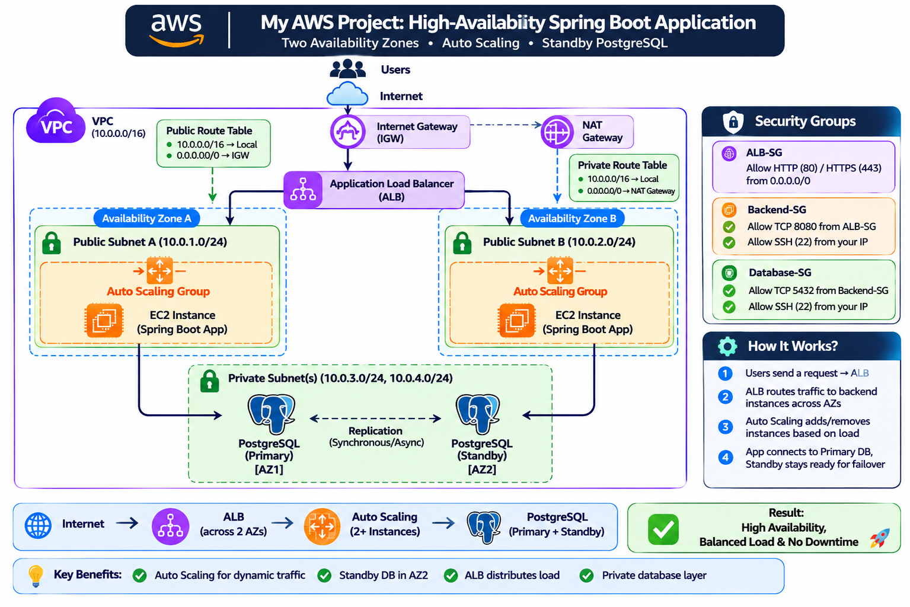

# Highly Available Spring Boot Backend on AWS

A multi-tier AWS deployment of a Spring Boot REST API with an Application Load Balancer, an Auto Scaling group, and a replicated PostgreSQL database running in private subnets across two Availability Zones.



---

## Table of Contents

- [Overview](#overview)
- [Architecture](#architecture)
- [Tech Stack](#tech-stack)
- [Network Design](#network-design)
- [Security Groups](#security-groups)
- [How It Works](#how-it-works)
- [Setup Guide](#setup-guide)
- [Load Testing](#load-testing)
- [Advantages](#advantages)
- [Limitations](#limitations)
- [Problems I Faced and How I Fixed Them](#problems-i-faced-and-how-i-fixed-them)
- [What I Learned](#what-i-learned)
- [Future Improvements](#future-improvements)
- [Cost Notes](#cost-notes)
- [Author](#author)

---

## Overview

This project shows how to take a simple Spring Boot API and deploy it on AWS in a way that is secure, scalable, and tolerant of failures.

Key goals:

- Keep the database **private**, with no public IP address.
- Run the backend in **two Availability Zones** behind a load balancer.
- **Scale automatically** when traffic increases and replace unhealthy servers.
- Remove the database as a **single point of failure** using PostgreSQL streaming replication (RDS Multi-AZ is not available in the free tier).

---

## Architecture

Traffic flow:

```
Internet -> Internet Gateway -> Application Load Balancer (port 80)
         -> Backend EC2 instances in an Auto Scaling group (port 8080, AZ-a and AZ-b)
         -> Primary PostgreSQL (port 5432, private subnet, AZ-a)
         -> Standby PostgreSQL (streaming replication, private subnet, AZ-b)
```

Main components:

| Component | Purpose |
|-----------|---------|
| VPC (`10.0.0.0/16`) | Isolated network for all resources |
| Public subnets (2) | Host the ALB and the backend instances, one per AZ |
| Private subnets (2) | Host the primary and standby databases |
| Internet Gateway | Internet access for public subnets |
| NAT Gateway | Outbound-only internet access for private subnets (package installs, updates) |
| Application Load Balancer | Distributes requests across backend instances and runs health checks |
| Target Group | Registers backend instances on port 8080 |
| Auto Scaling Group | Keeps 2 to 4 backend instances running and scales on CPU |
| Primary PostgreSQL (EC2) | Handles reads and writes |
| Standby PostgreSQL (EC2) | Read-only replica in a second AZ |

---

## Tech Stack

- **Cloud:** AWS (VPC, EC2, ALB, Auto Scaling, NAT Gateway, Security Groups, CloudWatch)
- **Backend:** Java, Spring Boot, Spring Data JPA, Spring Boot Actuator
- **Database:** PostgreSQL with streaming replication
- **Tools:** curl, ApacheBench / hey, systemd

---

## Network Design

> Adjust the CIDR ranges if yours are different.

| Resource | AZ | CIDR |
|----------|----|------|
| VPC | - | `10.0.0.0/16` |
| Public Subnet A | AZ-a | `10.0.1.0/24` |
| Public Subnet B | AZ-b | `10.0.2.0/24` |
| Private Subnet A (primary DB) | AZ-a | `10.0.3.0/24` |
| Private Subnet B (standby DB) | AZ-b | `10.0.4.0/24` |

**Route tables**

| Route table | Routes | Associated with |
|-------------|--------|-----------------|
| Public | `10.0.0.0/16 -> local`, `0.0.0.0/0 -> Internet Gateway` | Public subnets A and B |
| Private | `10.0.0.0/16 -> local`, `0.0.0.0/0 -> NAT Gateway` | Private subnets A and B |

---

## Security Groups

Traffic is allowed only along the path ALB -> Backend -> Database. Rules reference other security groups instead of IP addresses.

| Security group | Inbound rules |
|----------------|---------------|
| `alb-sg` | HTTP 80 from `0.0.0.0/0` (HTTPS 443 when a certificate is added) |
| `Backend-SG` | TCP 8080 from `alb-sg`; SSH 22 from my IP only |
| `Database-SG` | TCP 5432 from `Backend-SG`; TCP 5432 from `Database-SG` itself (replication); SSH 22 from the backend security group or my IP |

The database instances have **no public IP**, and nothing on the internet can reach port 5432.

---

## How It Works

1. A user sends a request to the load balancer's DNS name on port 80.
2. The ALB forwards the request to a healthy backend instance on port 8080, balancing across both AZs.
3. The Spring Boot application reads and writes data on the primary PostgreSQL instance over its private IP.
4. The primary streams changes to the standby in the second AZ.
5. The ALB runs health checks (`/actuator/health`). Unhealthy instances stop receiving traffic.
6. The Auto Scaling group replaces failed instances and adds more when average CPU stays above the target.

---

## Setup Guide

A summary of the steps. Replace placeholders such as `<db-private-ip>` with your own values.

### 1. Networking

1. Create the VPC (`10.0.0.0/16`).
2. Create two public and two private subnets across two AZs.
3. Create and attach an Internet Gateway.
4. Create a NAT Gateway in a public subnet with an Elastic IP.
5. Create the public and private route tables and associate them with the subnets.
6. Enable auto-assign public IPv4 on the public subnets.

### 2. Security groups

Create `alb-sg`, `Backend-SG`, and `Database-SG` with the rules listed above.

### 3. Primary database (private subnet A)

```bash
sudo apt update && sudo apt install -y postgresql
sudo -u postgres psql
```

```sql
CREATE DATABASE appdb;
CREATE USER appuser WITH PASSWORD '<strong-password>';
GRANT ALL PRIVILEGES ON DATABASE appdb TO appuser;
CREATE ROLE replicator WITH REPLICATION LOGIN PASSWORD '<replication-password>';
```

`postgresql.conf`:

```
listen_addresses = '*'
wal_level = replica
max_wal_senders = 5
```

`pg_hba.conf`:

```
host appdb       appuser    10.0.0.0/16               scram-sha-256
host replication replicator <standby-private-ip>/32   scram-sha-256
```

```bash
sudo systemctl restart postgresql
```

### 4. Standby database (private subnet B)

Install PostgreSQL, stop it, clear the data directory, and clone the primary (adjust the path for your PostgreSQL version):

```bash
sudo systemctl stop postgresql
sudo -u postgres rm -rf /var/lib/postgresql/16/main/*
sudo -u postgres pg_basebackup -h <primary-private-ip> -U replicator \
  -D /var/lib/postgresql/16/main -R -P
sudo systemctl start postgresql
```

Verify on the primary:

```sql
SELECT client_addr, state FROM pg_stat_replication;
```

The standby should show `streaming`.

### 5. Backend application

1. Install Java on a base instance and copy the jar.
2. Configure the database connection with the **private IP**:

   ```properties
   spring.datasource.url=jdbc:postgresql://<db-private-ip>:5432/appdb
   spring.datasource.username=appuser
   spring.datasource.password=<strong-password>
   ```

3. Run the app as a systemd service so it starts on boot (`/etc/systemd/system/app.service`):

   ```ini
   [Unit]
   Description=Spring Boot app
   After=network.target

   [Service]
   User=ubuntu
   ExecStart=/usr/bin/java -jar /home/ubuntu/app.jar
   Restart=always

   [Install]
   WantedBy=multi-user.target
   ```

   ```bash
   sudo systemctl daemon-reload
   sudo systemctl enable --now app
   ```

4. Confirm the health endpoint: `curl -i http://localhost:8080/actuator/health`

### 6. Load balancer

1. **Target group:** type Instances, HTTP, port 8080, health check path `/actuator/health`, success code `200`.
2. **ALB:** internet-facing, mapped to both public subnets, security group `alb-sg`, listener HTTP 80 forwarding to the target group.

### 7. Auto Scaling

1. Create an AMI from a working backend instance.
2. Create a launch template using that AMI, the `Backend-SG` security group, and the same instance type.
3. Create the Auto Scaling group:
   - Subnets: both public subnets
   - Attached to the existing target group, with ELB health checks enabled
   - Health check grace period: 120 to 180 seconds
   - Desired 2, minimum 2, maximum 4
   - Target tracking policy: average CPU utilization at 50%

### 8. Test

```bash
curl -X POST http://<alb-dns-name>/api/users/register \
  -H "Content-Type: application/json" \
  -d '{"name":"Ali","email":"ali@example.com","password":"secret123"}'

curl -X POST http://<alb-dns-name>/api/users/login \
  -H "Content-Type: application/json" \
  -d '{"email":"ali@example.com","password":"secret123"}'
```

---

## Load Testing

Tools: `hey` and ApacheBench.

```bash
hey -z 60s -c 50 -m POST -T "application/json" \
  -d '{"email":"ali@example.com","password":"secret123"}' \
  http://<alb-dns-name>/api/users/login
```

Results (fill in with your own numbers):

| Metric | Result |
|--------|--------|
| Concurrency | 50 |
| Duration | 60 s |
| Requests per second | `[add]` |
| p95 latency | `[add]` |
| Error rate | `[add]` |
| Instances after scale-out | `[add]` |

What I monitored in CloudWatch: `RequestCountPerTarget`, `TargetResponseTime`, `HTTPCode_Target_5XX_Count`, `HealthyHostCount`, and instance CPU.

---

## Advantages

- **High availability for the app tier:** servers run in two AZs, and the ALB stops sending traffic to unhealthy instances.
- **Self-healing and scaling:** the Auto Scaling group replaces failed instances and adds capacity under load.
- **Secure by design:** the database is private, and security groups allow only ALB -> Backend -> Database traffic.
- **No single database failure point:** a live replica in a second AZ keeps a copy of the data.
- **Free-tier friendly:** it uses plain EC2 instead of managed services that are not in the free tier.
- **Reusable pattern:** the same layout works for other backend applications.

---

## Limitations

- **Manual database failover:** if the primary fails, I must promote the standby (`SELECT pg_promote();`) and point the backends to it.
- **Asynchronous replication:** a few of the most recent writes can be lost if the primary crashes.
- **Self-managed database:** patching, backups, and monitoring are my responsibility.
- **Backends in public subnets:** the instances have public IPs. A stricter design puts them in private subnets so only the ALB is public.
- **No HTTPS yet:** traffic between clients and the ALB is unencrypted until a certificate is added.
- **Hourly-billed services:** the ALB and NAT Gateway are not free, so the stack should be deleted when not in use.
- **Production recommendation:** use RDS Multi-AZ for automatic failover and managed backups.

---

## Problems I Faced and How I Fixed Them

| Problem | Cause | Fix |
|---------|-------|-----|
| Targets unhealthy | Wrong health check path and response code | Used Spring Boot Actuator `/actuator/health` with success code `200` |
| ALB could not reach instances | Security group allowed 8080 from the wrong source | Allowed 8080 from `alb-sg` |
| `502 Bad Gateway` after enabling Auto Scaling | The app was not running on new instances | Ran the app as an enabled systemd service and rebuilt the AMI |
| RDS Multi-AZ not available | Free-tier limitation | Built PostgreSQL streaming replication on EC2 |
| Private instance had no internet | Missing route to the NAT Gateway | Added `0.0.0.0/0 -> NAT Gateway` to the private route table |

---

## What I Learned

- How public subnets, private subnets, route tables, Internet Gateways, and NAT Gateways work together.
- Why security groups should reference other security groups instead of IP addresses.
- How ALB health checks, target groups, and listeners behave.
- How launch templates and AMIs let an Auto Scaling group create identical servers.
- How PostgreSQL streaming replication works, and why it is not the same as automatic high availability.

---

## Future Improvements

- Move backend instances to private subnets, leaving only the ALB public.
- Add HTTPS with AWS Certificate Manager and redirect HTTP to HTTPS.
- Automate database failover with Patroni or repmgr.
- Schedule database backups to S3.
- Store secrets in AWS Secrets Manager or SSM Parameter Store.
- Define the infrastructure as code with Terraform.
- Add CloudWatch alarms and dashboards.

---

## Cost Notes

Some resources are billed hourly even with no traffic. When you finish testing:

- Delete the Application Load Balancer and NAT Gateway.
- Release unused Elastic IPs.
- Set the Auto Scaling group desired and minimum capacity to 0, or delete it.
- Stop or terminate database instances, and delete unused AMIs and snapshots.
- Set a billing alert in AWS Budgets.

---

## Security Notice

This repository does not contain passwords, keys, or real IP addresses. Use placeholders for all secrets, and never commit `.pem` files or `application.properties` with real credentials.

---

## Author

**Muhammad Saad**
GitHub: [muhammadsaadoo](https://github.com/muhammadsaadoo)

Feedback and suggestions are welcome. A LinkedIn comment about the single-AZ database is what led to the replication setup in this project.
